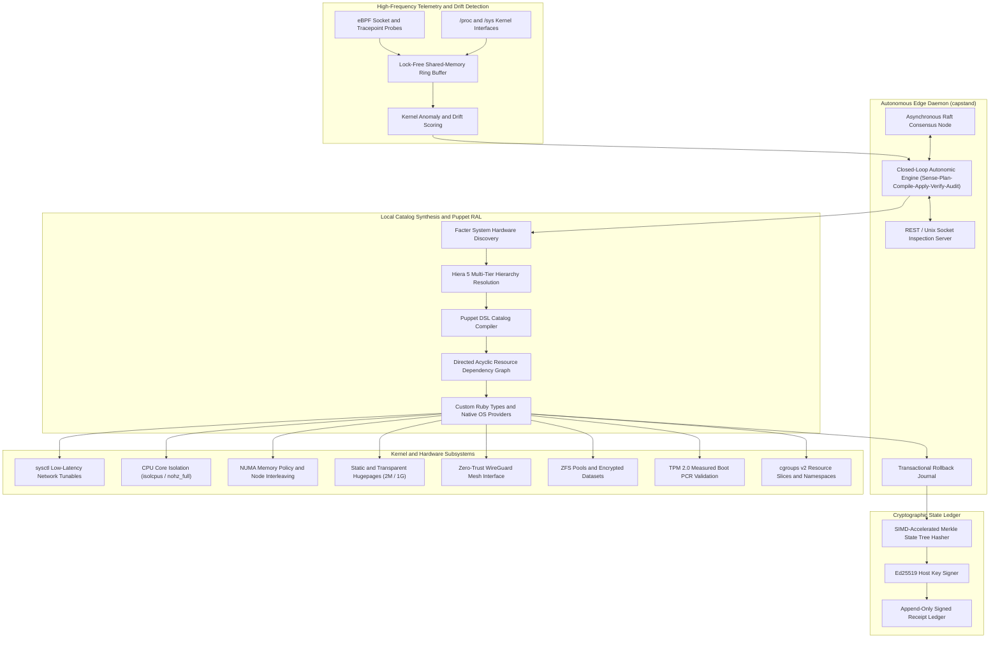

# Capstan

```
   ____    _    ____  ____ _____  _    _   _ 
  / ___|  / \  |  _ \/ ___|_   _|/ \  | \ | |
 | |     / _ \ | |_) \___ \ | | / _ \ |  \| |
 | |___ / ___ \|  __/ ___) || |/ ___ \| |\  |
  \____/_/   \_\_|   |____/ |_/_/   \_\_| \_|
```

> **Autonomous sovereign edge infrastructure mesh and deterministic telemetry-driven state convergence engine.**
>
> *Powered by the Puppet Resource Abstraction Layer (RAL), closed-loop autonomic reconciliation (`capstand`), low-latency Linux kernel orchestration, decentralized Raft consensus, zero-trust WireGuard overlays, and SIMD-accelerated cryptographic state proofs.*

[]()
[]()
[]()
[]()
[]()
[]()

---

## Overview

Capstan is a decentralized, autonomic infrastructure orchestration platform engineered for mission-critical edge computing environments: bare-metal financial colocation colos, autonomous robotics hives, distributed telecom points of presence (PoPs), and air-gapped secure enclaves.

Traditional infrastructure tools rely on a fragile centralized master polling pattern: nodes periodically execute catalog runs every 30 minutes over high-latency WAN links, creating single points of failure, vulnerabilities to network partitions, and zero reactivity to microsecond-level kernel drift.

Capstan reimagines infrastructure management by running an autonomous, closed-loop convergence daemon (`capstand`) directly on each edge host. Capstan couples the declarative expressiveness and strict idempotency of Puppet's Resource Abstraction Layer (RAL) with high-frequency eBPF telemetry, local-first catalog compilation, an embedded Raft consensus mesh, and SIMD-accelerated Merkle state trees.

---

## Architectural Decomposition



---

## Key Subsystems

### 1. Declarative Puppet Ecosystem (The Heart)
Capstan includes 10 production-grade Puppet modules structured according to the Roles and Profiles architecture pattern:
- **`capstan_core`**: Manages node identity, host key generation, filesystem hierarchy, autonomous daemon supervisor, and rollback journals.
- **`capstan_kernel`**: Orchestrates low-latency kernel tuning, CPU core isolation (`isolcpus`), NUMA memory policies, static hugepage pools (2MB and 1GB), IRQ affinity balancing, and deterministic I/O queue schedulers.
- **`capstan_network`**: Configures the encrypted WireGuard overlay mesh, attaches eBPF XDP line-rate packet filters, applies token bucket traffic shaping, and isolates network routing via VRF domains.
- **`capstan_security`**: Hardware-enforced defense: TPM 2.0 measured boot PCR attestation, seccomp-bpf syscall sandboxes, AppArmor profiles, immutable auditd rules, SSH CA trust anchors, and ephemeral mutual TLS.
- **`capstan_telemetry`**: High-frequency kernel tracepoints, Prometheus metrics export, OpenTelemetry collector integration, and automated divergence scoring.
- **`capstan_storage`**: Resilient edge storage: ZFS pool and dataset lifecycle, LUKS2 encrypted volume keyslots, NVMe-oF target provisioning, and snapshot retention.
- **`capstan_workload`**: Deterministic micro-container sandboxing, cgroups v2 resource quotas, and isolated network/mount namespaces.
- **`capstan_cluster`**: Decentralized Raft consensus coordination, quorum health probes, and cluster membership tracking.
- **`capstan_gateway`**: Edge ingress and egress proxying, dynamic TLS termination, layer-4/7 health probes, and circuit breaking.
- **`capstan_audit`**: Cryptographically signed state receipts, Merkle audit trails, and immutable ledger verification.

### 2. Custom Ruby Types and Native Providers (RAL)
Custom resource types allow operators to declare low-level kernel abstractions directly within Puppet manifests:
- `wireguard_tunnel`: Configures tunnel interfaces, listen ports, and dynamic peer cryptographic keys.
- `ebpf_filter`: Attaches line-rate XDP or tc bytecode filters to network interfaces.
- `cpu_isolation`: Dedicates isolated CPU core masks and manages cgroups v2 cpuset boundaries.
- `zfs_dataset`: Orchestrates ZFS datasets, mountpoints, compression algorithms (lz4, zstd), and record sizes.
- `tpm_pcr_policy`: Validates hardware TPM 2.0 platform configuration register digests for measured boot attestation.
- `raft_peer`: Manages consensus voting membership in the distributed cluster topology.
- `luks_volume`: Formats and opens hardware-encrypted block devices using LUKS2 keyslots.
- `seccomp_profile`: Enforces default-deny syscall filter profiles.

### 3. Custom Puppet Functions and Facter Facts
- **`capstan::cidr_split`**: Subnet calculation and IP address allocation for mesh overlays.
- **`capstan::merkle_root`**: Cryptographic SHA-256 Merkle root computation across resource hashes.
- **`capstan::peer_mesh`**: Topology generator constructing WireGuard peer configurations.
- **`capstan_agent`**: Facter fact reporting local daemon version, socket status, and directory layout.
- **`capstan_node_id`**: Discovers authoritative cryptographic node UUID and hardware serial.
- **`capstan_numa`**: Probes NUMA nodes, socket affinities, and memory distribution.
- **`capstan_wireguard`**: Inspects active WireGuard interfaces, MTUs, and handshake states.
- **`capstan_tpm`**: Reports TPM 2.0 hardware presence, manufacturer, and PCR SHA-256 digests.
- **`capstan_drift`**: Real-time divergence score comparing live system state against compiled catalog.

### 4. Autonomous Daemon (`capstand`)
Written in Python with an asynchronous event loop:
- **Autonomic Loop**: Executes continuous Sense -> Plan -> Compile -> Apply -> Verify -> Audit cycles.
- **Local Compiler Bridge**: Compiles Puppet catalogs in-memory, parses resource graphs, and detects dependency cycles via Kahn's topological sort algorithm.
- **Decentralized Raft**: Asynchronous Raft consensus node handling leader election, log replication, and split-brain mitigation.
- **Inspection API**: Serves JSON endpoints over Unix domain sockets and HTTP (`/health`, `/status`, `/ledger`, `/trigger`).

### 5. High-Performance Native Kernels (`libcapstan`)
Engineered in C99 with SIMD acceleration:
- **SIMD Merkle Hasher**: AVX2 / ARM NEON accelerated SHA-256 state tree construction.
- **Lock-Free Ring Buffer**: Single-producer multi-consumer shared-memory ring buffer using atomic operations and memory fences for microsecond telemetry streaming.
- **CAP1 Binary Framing**: Zero-copy packet framing with Castagnoli CRC-32C verification.

---

## Interactive Operator Dashboard

Capstan includes an interactive terminal CLI (`bin/capstan`) and live ASCII dashboard:

```
+-----------------------------------------------------------------------------+
|  CAPSTAN EDGE CONTROL PLANE DASHBOARD           2026-11-14 23:03:35 UTC     |
+-----------------------------------------------------------------------------+
| Node: edge-node-01         Cluster: edge-mesh-alpha      Status: CONVERGED  |
+-----------------------------------------------------------------------------+
| [TELEMETRY METRICS]                                                         |
|   eBPF Probes: ACTIVE (XDP Line-Rate, Tracepoint latency: 12 us)           |
|   Sampling: 100 Hz | Drift Score: 0.00% [................] In-Sync          |
|   Ring Buffer: 16384 slots (0.2% utilized, 0 drops)                         |
+-----------------------------------------------------------------------------+
| [RAFT CONSENSUS QUORUM]                                                     |
|   Role: LEADER | Term: 3 | Commit Index: 142 | Quorum: 3/3 Healthy          |
|   Peers:                                                                    |
|     * edge-node-01 (10.42.0.1:7000) [LOCAL] [VOTER]                         |
|     * edge-node-02 (10.42.0.2:7000) [ONLINE] [VOTER] RTT: 1.2ms             |
|     * edge-node-03 (10.42.0.3:7000) [ONLINE] [VOTER] RTT: 1.5ms             |
+-----------------------------------------------------------------------------+
| [PUPPET CATALOG STATE GRAPH]                                                |
|   Site Manifest: manifests/site.pp                                          |
|   Active DAG: Directories -> Identity -> Security -> Wireguard -> Service  |
|   Total Resources: 42 | In-Sync: 42 | Changed: 0 | Failed: 0                |
|   Last Merkle Root: 19ae64474340b3f83102a49855c60c4dd4aa4c3a4f8c1ed3...     |
+-----------------------------------------------------------------------------+
```

---

## Quickstart

### Prerequisites
- macOS or Linux (x86_64 or arm64)
- Puppet (>= 7.0.0 or 8.x)
- Python (>= 3.9)
- GCC or Clang (C99 compiler)
- Make

### Verification and Execution
Run the automated multi-stage verification suite:

```bash
# Clone the repository
git clone https://github.com/Aneesh495/capstan.git
cd capstan

# Execute root automated verification harness
./scripts/verify.sh
```

### CLI Operational Commands
```bash
# Display node status and telemetry parameters
./bin/capstan status

# Synthesize Puppet catalog and preview execution DAG
./bin/capstan plan

# Trigger an immediate atomic state convergence pass
./bin/capstan apply

# Inspect distributed Raft consensus cluster and peers
./bin/capstan cluster

# Display cryptographic state receipts and Merkle root audit ledger
./bin/capstan audit

# Launch live ASCII terminal dashboard
./bin/capstan top
```

---

## Repository Directory Layout

```
capstan/
├── bin/                          # Executable entrypoints (capstan, capstand)
├── c_src/                        # Native C99 kernels (SIMD Merkle, Ring Buffer, CRC-32C)
├── capstand/                     # Autonomous Python daemon package
│   ├── api/                      # Inspection HTTP and Unix socket API server
│   ├── compiler/                 # Puppet catalog compiler bridge and DAG evaluator
│   ├── consensus/                # Asynchronous Raft consensus and cluster FSM
│   ├── engine/                   # Closed-loop autonomic convergence pipeline
│   ├── ledger/                   # Merkle state tree and cryptographic receipts
│   ├── telemetry/                # High-frequency telemetry and kernel anomaly monitor
│   └── tui/                      # Live ASCII terminal dashboard
├── docs/                         # Specifications, architecture diagrams, runbooks
├── hieradata/                    # Hiera 5 data hierarchies (common, tiers, roles)
├── manifests/                    # Primary site entrypoint (site.pp)
├── modules/                      # Puppet modules
│   ├── capstan_audit/            # State receipt ledger and compliance proofs
│   ├── capstan_cluster/          # Raft consensus peer types and topology
│   ├── capstan_core/             # Node identity, supervisor, and rollback journals
│   ├── capstan_gateway/          # Edge ingress proxy and TLS termination
│   ├── capstan_kernel/           # Low-latency sysctl, CPU isolation, NUMA, hugepages
│   ├── capstan_network/          # WireGuard mesh, eBPF XDP filters, and VRF
│   ├── capstan_security/         # TPM 2.0 PCR attestation, seccomp-bpf, AppArmor
│   ├── capstan_storage/          # ZFS datasets, LUKS2 encryption, NVMe-oF
│   ├── capstan_telemetry/        # eBPF tracepoints, Prometheus metrics, drift scoring
│   └── capstan_workload/         # cgroups v2 resource slices and sandboxes
├── site-modules/                 # Roles and Profiles control-repo layer
│   ├── profile/                  # Technology profiles (base, gateway, hypervisor, etc.)
│   └── role/                     # Top-level functional roles
├── scripts/                      # Verification test runners and integrity checkers
├── spec/                         # Ruby RSpec-puppet test suite
└── tests/                        # Comprehensive Python pytest suite
```

---

## License

MIT License. Copyright (c) 2026 Aneesh Krishna.
