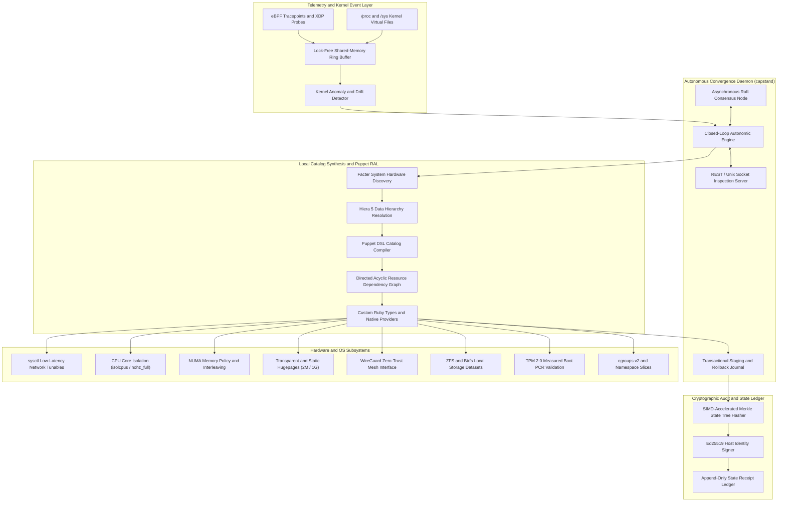
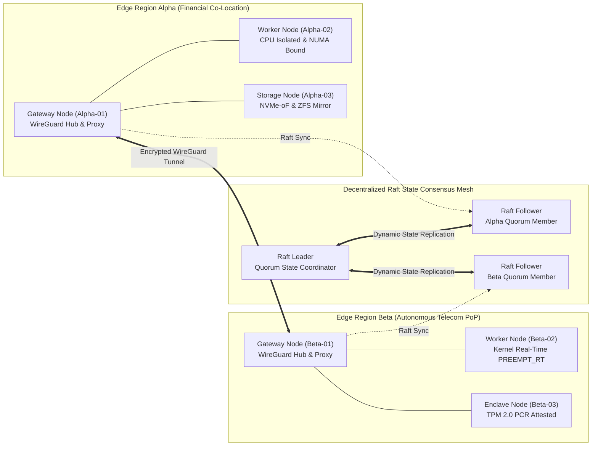
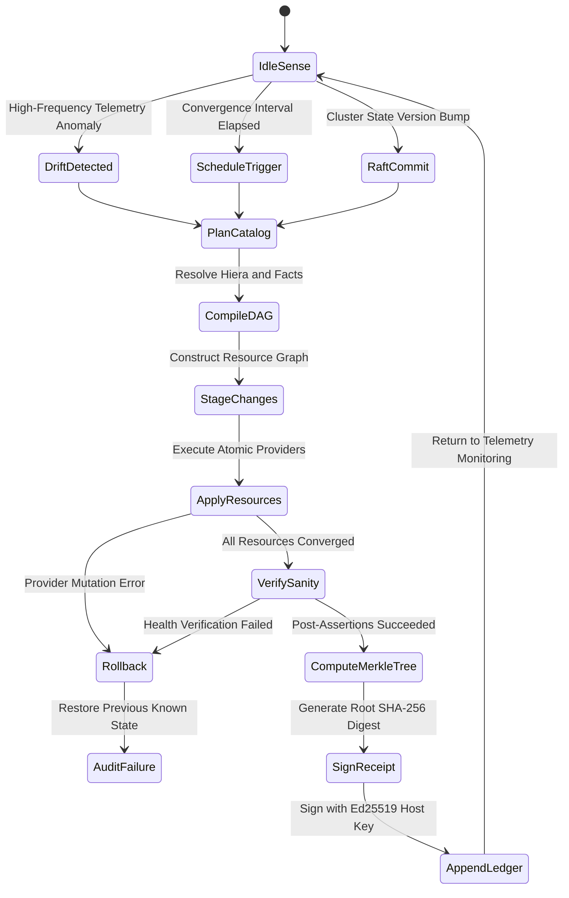

# Capstan: Architecture and Topology Specifications

## Node Internal Architecture

The following diagram illustrates the internal subsystem decomposition of an autonomous Capstan edge node, highlighting the closed-loop convergence pipeline, the Puppet Resource Abstraction Layer, kernel telemetry probes, and the cryptographic state ledger.

---

## Distributed Cluster Mesh Topology

Capstan edge clusters form an encrypted peer-to-peer overlay network orchestrated through WireGuard tunnels and synchronized via Raft consensus.

---

## Autonomic Convergence State Machine

The state machine below delineates the transitions executed by `capstand` during continuous system reconciliation.

